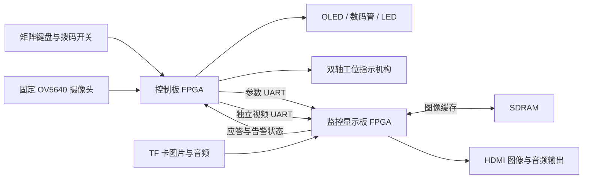

# 晶链智检

基于安路 FPGA 的半导体智能产线多媒体监控与可视化终端

## 项目介绍

这是我们参加2026全国大学生嵌入式芯片与系统设计大赛 FPGA 创新赛道安路赛道赛题一的作品。我们用两块安路 EG4S20 开发板，搭建了一套可以显示工艺参数、查看现场画面、播放图片和音频，并在异常时指向对应工位的演示装置。

控制板连接矩阵键盘、OLED、摄像头和两个舵机，负责输入演示数据、处理图像和控制工位指示机构。显示板负责接收数据、判断参数是否越限，再把工艺页面、现场画面和音频分析结果通过 HDMI 输出。

同时拓展了摄像头，固定朝向 A、B、C 三个工位。某个工位的参数持续异常后，屏幕会标出需要查看的区域，舵机带动指示机构转向对应位置。操作人员可以确认、手动调整方向，源异常解除后，机构按控制流程回中。

目前电压、电流、温度、缺陷数和良率等数据由按键或内部演示逻辑生成，尚未连接真实产线设备。

## 已完成的功能

### 参数监控与双板通信

- 显示电压、电流、温度、设备号、批次、片号、缺陷数和良率。
- 通过矩阵键盘修改参数，支持故障注入、噪声叠加、自动发送和自动走片。
- 阈值先在控制板本地编辑，再统一下发给显示板。
- 支持持续越限判断、数据过期提示和参数恢复后的自动撤警。
- 显示板可通过拨码开关触发手动声光报警。
- 参数通信使用独立 UART，支持可选 CRC16 校验、OK/ER 应答和告警状态回传。

### 图片与音频播放

显示板从 FAT32 格式的 TF 卡读取四组图片和配对音频。图片加载到 SDRAM 后，可以手动切换，也可以自动轮播。

图片部分支持等比缩放、居中补边、2×2 缩略图和转场。菜单中可以调整亮度、对比度、轮播周期、昼夜模式及色彩效果，还可以叠加动态参数和滚动字幕。

音频按图片编号配对，切图时从头播放对应 WAV，停留时循环播放。音量可以通过菜单调整；对应 WAV 不可用时，程序会回退到内部旋律。内部测试音也可以用于检查 HDMI 音频输出。

### 音频可视化

- 显示时域波形、64 柱频谱和峰值保持。
- 波形和频谱可以分别开启，也可以同时显示。
- 对播放音频进行高频超限判断，在界面上给出提示。

这部分分析的是 TF 卡中正在播放的音频。现场声音采集还需要增加麦克风和采集电路。

### 摄像头与图像处理

OV5640 采集固定视角的现场图像，由控制板处理后，通过独立视频串口发送到显示板，在 PIC4 页面中显示。

目前保留了以下处理模式：

| 模式 | 内容 |
| --- | --- |
| 原图 | 显示彩色现场画面 |
| Sobel 边缘 | 提取画面中的边缘 |
| 3×3 卷积 | 锐化、高斯平滑、拉普拉斯轮廓、浮雕和固定参数特征提取 |
| 帧差分区 | 标出运动像素，并显示 A/B/C 工位分界 |

程序中名为 CNN 的子模式使用固定参数完成特征提取，没有训练分类器，也不输出缺陷类别。

### 工位指向与巡检

A、B、C 三个工位可以分别保存水平和俯仰预置角度。开启自动控制后，可以选择巡检、本地运动联动，或同时开启两者。

参数告警由显示板判断，再回传给控制板。本地运动判断则由控制板完成：把摄像头画面分成三个区域，统计各区运动点占比，满足条件后调用对应预置位。

任务优先级为：

```text
人工方向控制 > 看板参数告警 > 本地运动联动 > 空闲巡检
```

人员确认只表示已经查看，源参数仍异常时，屏幕继续保留告警。画面中的运动颜色由控制板生成，CHECK 框由显示板的参数告警驱动。

摄像头始终固定，舵机带动工位指示机构。机构执行预置角度指令，没有机械位置反馈。工位预置位保存在寄存器中，重新上电后需要重新标定。

### 操作与调试

控制板使用 4×4 矩阵键盘、拨码开关、OLED、数码管和 LED 进行操作及状态显示。OLED 会根据当前模式显示对应的按键功能，并提示阈值未下发、链路状态和待人工确认等信息。

显示板提供按键菜单、UART 控制、字幕输入和 Flash 配置保存。工程还保留了摄像头诊断及内置测试图，方便分别检查图像采集、通信和显示链路。

## 系统结构



## 主要参数

| 项目 | 配置 |
| --- | --- |
| FPGA | 两片安路 EG4S20BG256 |
| 开发语言 | Verilog HDL |
| 开发工具 | Tang Dynasty 6.2 系列 |
| HDMI 分辨率 | 固定 640×480 |
| 图片缓存 | 四路 SDRAM 帧缓存 |
| BMP 格式 | 24/32 位无压缩 BMP，宽高各为 1～2048 像素 |
| 图片浏览 | 最多四张，支持 2×2 缩略图 |
| 自动轮播周期 | 2、3、5、10 秒 |
| WAV 格式 | PCM、48 kHz、16 位、单声道或双声道 |
| 频谱分析 | 512 点 Hann 窗、64 个选定 DFT 频点 |
| 摄像头传输图像 | 160×120，RGB332 |
| 现场窗口 | 320×240 |
| 参数串口 | 115200 bit/s，8N1 |
| 视频串口 | 3.125 Mbit/s，8N1 |
| OLED | SSD1306，128×64，I²C |
| 舵机控制 | 双路 50 Hz PWM |
| 工位预置 | A、B、C 三个工位 |

表中列出的是程序配置和支持范围。参数调节步长、角度指令及程序判定时间，需要与实际测量精度、机械定位精度和实测响应时间分开看。

## 工程目录

本地交付工程放在 `Finish/prj 1/` 下：

```text
Finish/prj 1/
├── sender_board/
│   ├── src/                       控制板 RTL
│   ├── constraints/               控制板引脚与时序约束
│   ├── td/sender.al               控制板 TD 工程
│   └── 控制板操作说明.md
├── src/
│   ├── user_source/
│   │   ├── hdl_source/            显示板 RTL
│   │   ├── ip_source/             IP 文件
│   │   └── constraints_source/    显示板引脚与时序约束
│   ├── td_project/                显示板 TD 工程
│   └── sim/                       模块与通信仿真用例
├── tf_card/                       TF 卡图片素材
├── tools/                         PC 辅助工具
└── work/                          专项验证记录与历史实现资料
```

打开工程时使用这两个入口：

- 控制板：`sender_board/td/sender.al`，顶层模块为 `sender_top`。
- 显示板：`src/td_project/HDMI1.4b_Transmitter_v1.0.al`，顶层模块为 `top`。


## 运行方法

### 准备硬件

需要两块对应工程的 FPGA 开发板、HDMI 显示及音频设备、FAT32 TF 卡、OV5640 摄像头、SSD1306 OLED、双轴舵机和连接线。

两块板及外设需要共地。舵机建议使用独立的适配电源，避免动作时的电流变化影响开发板供电。

### 准备 TF 卡

将以下文件放到 TF 卡根目录：

```text
PIC1.BMP
PIC2.BMP
PIC3.BMP
PIC4.BMP
MUSIC1.WAV
MUSIC2.WAV
MUSIC3.WAV
MUSIC4.WAV
```

`PICn.BMP` 与 `MUSICn.WAV` 按编号配对，注意检查文件格式和扩展名。

### 连接两块板

| 控制板 | 显示板 | 用途 |
| --- | --- | --- |
| J1，TX | P4，RX | 参数发送 |
| K2，RX | N4，TX | 应答和告警状态回传 |
| P12，视频 TX | M1，视频 RX | 摄像头视频传输 |
| GND | GND | 公共地 |

摄像头、OLED 和舵机的接线见约束文件及控制板操作说明。

### 编译与下载

分别打开两块板的 TD 工程，检查器件、源文件和约束，完成综合、布局布线、时序检查及比特流生成。

下载前确认比特流与当前源码对应，并写入正确的开发板。如果需要断电后自动启动，还需要按开发板的下载流程固化到配置 Flash。

### 演示顺序

1. 插入 TF 卡，连接 HDMI，两块板上电。
2. 开启控制板自动发送，检查屏幕参数和链路状态。
3. 测试切图、缩略图、轮播、菜单及音频显示。
4. 进入现场视觉模式，在 PIC4 页面观察不同算法的效果。
5. 标定 A/B/C 工位预置位，再开启自动控制。
6. 注入参数异常，观察屏幕告警、CHECK 标记和机构指向。
7. 执行人工确认，再恢复源参数，观察撤警与回中。
8. 切换巡检和本地运动联动模式，检查各工位的触发情况。

## 完成情况与待改进部分

目前已经完成双板功能集成。技术文档中记录了整机实物、HDMI 和 OLED 界面、图像处理效果以及工位联动演示。工程中也保留了 RTL、约束文件、仿真用例、TD 报告和比特流产物。

现有显示板布局布线报告中，建立和保持时序仍有负裕量，这部分还需要继续优化。模块仿真、工程构建和实物演示各自能验证的内容不同，已有演示记录也不能代替长期运行测试。

后续可以继续接入真实传感器或设备接口，并增加现场声音采集。

这是我们团队首次参与FPGA创新设计赛道，欢迎各位的批评与指正！
